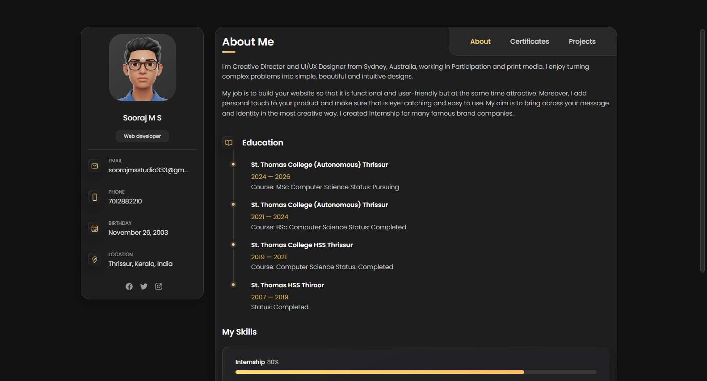
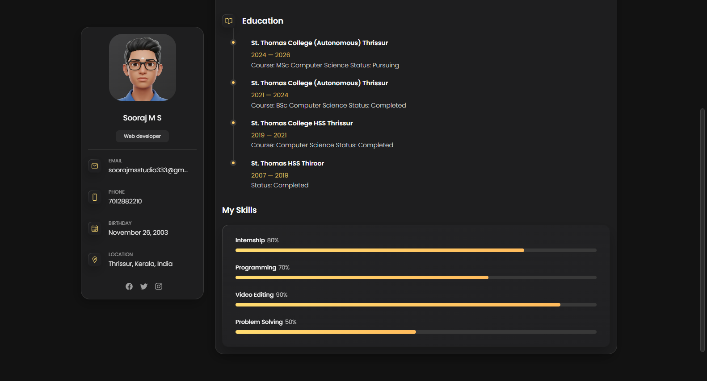

# Personal_Portfolio_Website

<p align="center">
  
  
  
  
  
</p>

A clean, responsive personal developer portfolio web application. Features modern dark aesthetic card layouts, interactive tabbed navigation, technical skill matrices, career milestones, and portfolio project showcases.

---

## 📸 Hero Preview

<p align="center">
  
</p>

## 🖼️ UI Snapshot Gallery

<p align="center">
  
  
</p>

---

## ✨ Features

- 👤 **Developer Profile Showcase** - Personal bio, verified contact badges, location indicators, and social links.
- 🎓 **Education & Career Timeline** - Clean milestone chronological views with certificates and experience highlights.
- ⚡ **Technical Skills Matrix** - Proficiency meters for frontend, backend, tools, and databases.
- 🎨 **Portfolio Project Cards** - Filterable project gallery with preview thumbnails, tags, and GitHub source links.
- 📱 **Fully Responsive Layout** - Responsive layout with smooth collapsible mobile drawer navigation.

---

## 🛠️ Tech Stack

- **Markup & Layout**: HTML5 Semantic Architecture
- **Styling**: Modern CSS3, Flexbox, CSS Grid, Custom Variables
- **Interactivity**: Vanilla JavaScript (ES6+)

---

## 🚀 Quick Start

### 1. Clone the repository
```bash
git clone https://github.com/soorajstudio/Personal_Portfolio_Website.git
cd Personal_Portfolio_Website
```

### 2. Run locally
```bash
# Using Python
python -m http.server 8080

# Or using Node
npx serve .
```

Open [http://localhost:8080](http://localhost:8080) in your browser.

---

## 📄 License

This project is licensed under the MIT License — see the [LICENSE](LICENSE) file for details.

Developed with ❤️ by [Sooraj Studio](https://github.com/soorajstudio).
